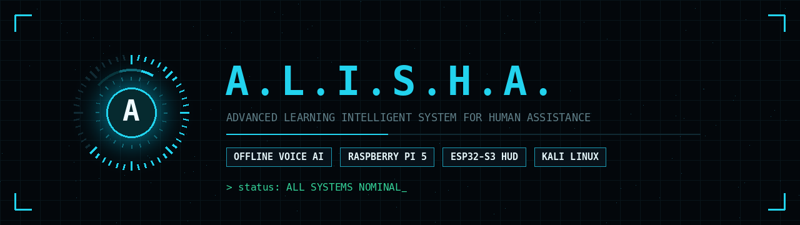
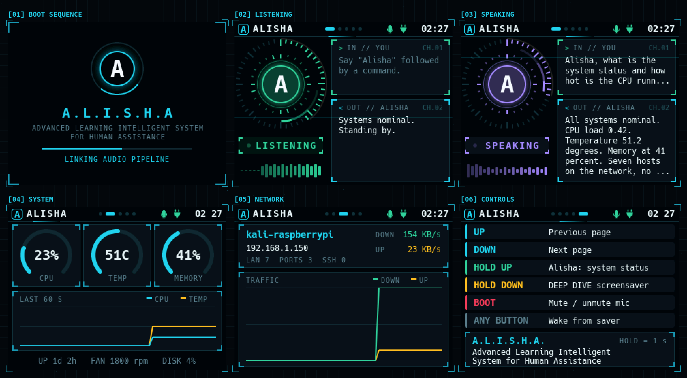
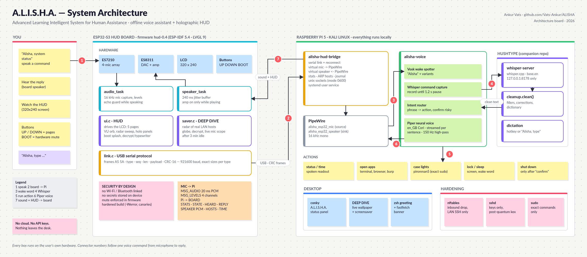

<p align="center">
  
</p>

<p align="center">
  
  
  
  
</p>

<p align="center"><b>A private, offline voice assistant with a holographic HUD: a personal AI that lives on your desk, not in someone else's cloud.</b></p>

---

## `> SYSTEM BRIEFING`

**A.L.I.S.H.A.** (*Advanced Learning Intelligent System for Human Assistance*) turns a Raspberry Pi 5 running Kali Linux and a small ESP32-S3 board into a voice assistant you can talk to.

- **She listens** through the board's microphone array.
- **She understands** you with Whisper, running locally.
- **She answers** in a natural female voice through the board's speaker.
- **She shows what she's doing** on a futuristic 320×240 HUD.

All of it runs on your own hardware. There are no accounts, no API keys, and no audio leaving the room.

```text
 you ──"Alisha, system status"──▶  mic array ─▶ wake word ─▶ Whisper ─▶ intent ─▶ action
                                                                                   │
 you ◀──"All systems nominal…"──  board speaker ◀─ Piper neural voice ◀────────────┘
```

## `> WHY I BUILT IT`

It started with a small ESP32-S3 "AI box" sitting on my desk, dead. Its stock firmware relied on a cloud AI preview API that had been retired, so every request failed. When I read the flash to see why, I found **my OpenAI API key and Wi-Fi password stored in plain text**.

That was the moment. I didn't want an assistant that:
- stops working when a company changes its API,
- keeps secrets where anyone with a USB cable can read them,
- or sends everything I say to a server I don't control.

So I rebuilt the whole thing from scratch with one rule: **everything runs locally, and security comes first.** The board became a hardened mic, speaker and display with no Wi-Fi code at all. The Raspberry Pi became the brain. A.L.I.S.H.A. is the result: an assistant that's *mine*, that works offline, and that looks like it belongs in a sci-fi film.

## `> VISUAL FEED`

<p align="center">
  
</p>

<p align="center"><sub>Real screens from the firmware, rendered with the built-in desktop preview (<code>esp32-hud/sim</code>).</sub></p>

## `> CAPABILITIES`

| Module | What it does |
|---|---|
| 🎙️ **Voice core** | Wake word "Alisha" (Vosk), then Whisper for accurate command recognition. Uses the same correction rules as [HushType](https://github.com/Vats-Ankur/hushtype): fillers removed, self-corrections applied. |
| 🗣️ **Neural voice** | [Piper](https://github.com/OHF-Voice/piper1-gpl) speech in a natural British female voice (Cori), streamed sentence by sentence so replies start in about 1.5 s. |
| 🛰️ **Holographic HUD** | Custom ESP32-S3 firmware (ESP-IDF 5.4, LVGL 9) with a boot sequence and a reactor orb with a voice-reactive tick ring and radar sweep. Also: holo panels, text that "decrypts", typewriter replies, and system/network/activity pages. |
| 🔊 **Board audio** | The 4-mic ES7210 array appears on the Pi as a USB microphone, and the ES8311 speaker as a sound output. It has a jitter buffer and an echo guard, so Alisha never hears herself. |
| 🌌 **DEEP DIVE** | A live desktop wallpaper and screensaver that adapts to the screen: LAN radar, globe, decryption stream and signal panels driven by real system data. |
| 🛡️ **Hardening** | nftables firewall (inbound drop), SSH limited to the LAN, a minimal sudoers rule set, and a firmware threat model ([`SECURITY.md`](esp32-hud/SECURITY.md)). |
| ⌨️ **Dictation** | "Alisha, type…" hands over to HushType, which types whatever you say into any window. |

### Voice commands
| Say | Result |
|---|---|
| "Alisha, **system status**" | CPU load, temperature and memory, spoken |
| "Alisha, **what time is it**" | The time |
| "Alisha, **open terminal / browser / burp**" | Launches the app |
| "Alisha, **set lights** red / green / blue / rainbow" | Pironman 5 case lighting |
| "Alisha, **run matrix**" / "**lock the screen**" | Just that |
| "Alisha, **type**" / "Alisha, **type** hello world" | Dictation through HushType |
| "Alisha, **go to sleep**" | Stops listening for commands until woken |
| "Alisha, **shut down**" | Asks you to say "confirm" first |

## `> ARCHITECTURE`

<p align="center">
  <a href="docs/architecture.svg"></a>
</p>

<p align="center"><sub>Whiteboard-style architecture board. Numbered connectors follow one request end to end. Click it for the full-size, editable SVG; regenerate it with <code>scripts/make_architecture.py</code>.</sub></p>

**Link security:**
- Every serial frame is length-capped and CRC-checked, and each message type must have an exact size.
- Text crossing the link is reduced to printable ASCII.
- Mute is enforced in firmware: the Pi cannot unmute the microphone.

## `> HARDWARE`

| Part | Notes |
|---|---|
| Raspberry Pi 5 | Kali Linux, XFCE, PipeWire. The Pironman 5 case is optional (it adds the light commands). |
| LCKFB ESP32-S3 board (16 MB flash, PSRAM) | ES7210 mic ADC, ES8311 codec with amplifier, 320×240 SPI LCD, UP/DOWN/BOOT buttons |
| USB cable | The board's only connection: power and data |

## `> REPOSITORY MAP`

```text
voice/            Alisha's brain: wake word, Whisper commands, Piper voice, actions
esp32-hud/
  firmware/       ESP-IDF project: board bring-up, audio, LVGL HUD, DEEP DIVE board saver
  host/           USB bridge: virtual mic and speaker, stats feed, systemd unit
  sim/            Desktop preview: renders every HUD screen on the Pi, no board needed
desktop/          DEEP DIVE live wallpaper + xfce4-screensaver theme
conky/ fastfetch/ shell/    Desktop panel, terminal banner, zsh greeting
systemd/ autostart/ xfce-screensaver/    Start everything at login
system/           Firewall, SSH and sudo hardening (review before use)
scripts/          Font converter, README art, wallpaper, export tooling
docs/             Setup log and images
```

## `> DEPLOY`

> Tested on a Raspberry Pi 5 with Kali Linux (2026). The paths assume the user `kali` and the project at `~/Documents/ALISHA-Setup`. Adjust them for your setup.

1. **Voice**
   ```bash
   bash voice/setup_voice.sh                       # Vosk, audio libraries, venv in ~/alisha-voice
   ~/alisha-voice/venv/bin/python -m pip install piper-tts
   ```
   Download `en_GB-cori-medium.onnx` and its `.json` from [rhasspy/piper-voices](https://huggingface.co/rhasspy/piper-voices) into `~/alisha-voice/models/`. Then copy `voice/` to `~/.config/alisha/voice/` and install `systemd/alisha-voice.service`.
2. **Speech-to-text:** install [HushType](https://github.com/Vats-Ankur/hushtype). It runs the local Whisper server that Alisha uses for commands.
3. **Firmware** (ESP-IDF 5.4):
   ```bash
   cd esp32-hud/firmware && idf.py build && idf.py -p /dev/ttyUSB0 flash
   ```
4. **Bridge:** link `esp32-hud/host/alisha-hud-bridge.service` into `~/.config/systemd/user/`, then:
   ```bash
   systemctl --user enable --now alisha-hud-bridge
   ```
5. **Desktop (optional):**
   ```bash
   python3 -m venv --system-site-packages desktop/.venv && desktop/.venv/bin/pip install -r desktop/requirements.txt
   ```
   Then copy the `autostart/` and `xfce-screensaver/` entries into place.
6. **Hardening (optional):** read `system/` carefully and adapt the LAN range before copying anything into `/etc`.

**Preview the HUD without the board:**
```bash
cd esp32-hud/sim && ./build.sh    # then open shots/sheet.png
```

## `> PRIVACY & SECURITY`

- **Zero cloud:**
  - Wake word: Vosk.
  - Speech-to-text: Whisper, through HushType.
  - Voice: Piper.

  Everything runs on the Pi.
- **The board can't phone home:** no Wi-Fi or Bluetooth code is linked into the firmware, and it stores no secrets.
- **Hardware mute:** the BOOT button cuts the microphone in firmware.
- **Unprivileged services:** the bridge and voice run as user services, and talk over owner-only Unix sockets.

## `> ROADMAP`

- [ ] Optional local LLM for open conversation (llama.cpp / Ollama)
- [ ] Voice selection and volume control by voice
- [ ] Secure Boot v2 + flash encryption for the board ([`SECURITY.md`](esp32-hud/SECURITY.md))
- [ ] One-line installer

## `> LICENSE & CREDITS`

Created by **Ankur Vats** ([@Vats-Ankur](https://github.com/Vats-Ankur)).

- **License:** [Apache License 2.0](LICENSE). You're welcome to use, study and build on this project. Keep the [NOTICE](NOTICE) file and credit the original author.
- **The name:** "ALISHA" and "A.L.I.S.H.A." are this project's name and are **not** licensed. If you publish a modified version, give it your own name.

Built with [LVGL](https://lvgl.io), [ESP-IDF](https://github.com/espressif/esp-idf), [Piper](https://github.com/OHF-Voice/piper1-gpl), [Vosk](https://alphacephei.com/vosk/), [whisper.cpp](https://github.com/ggml-org/whisper.cpp), the [Hack](https://sourcefoundry.org/hack/) font and [Font Awesome](https://fontawesome.com) icons. Their licenses are listed in [NOTICE](NOTICE).

<p align="center"><sub><code>// A.L.I.S.H.A. online. Say "Alisha", followed by a command.</code></sub></p>
